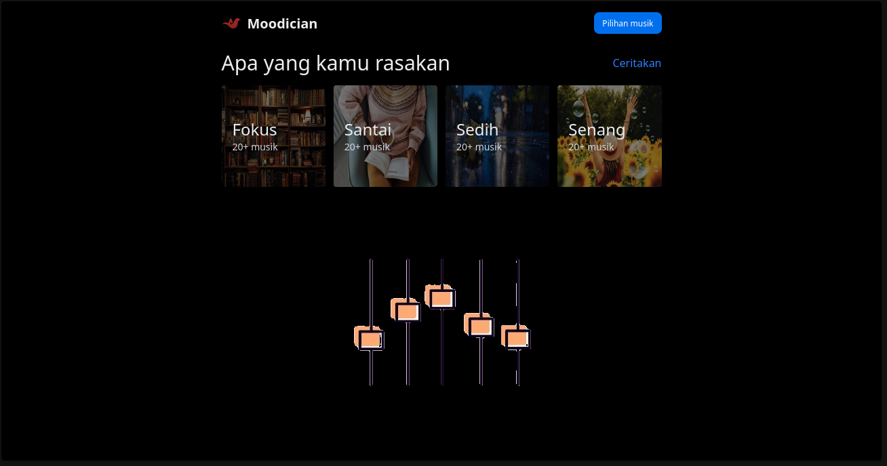

# Moodician

**Find the music that matches your mood.**

Moodician is a mood-based music discovery web application that helps users explore music based on how they feel. Whether you're looking for focus, relaxation, sadness, or happiness, Moodician makes it easier to find music that fits your current mood.

Built with React, TypeScript, and Appwrite, Moodician combines a clean, dark-themed interface with a simple and intuitive music discovery experience.

## Features

- **Mood-Based Music Discovery** — Explore music based on different moods.
- **Focus Mode** — Discover music for studying and productive work.
- **Relaxing Music** — Find music for relaxing and unwinding.
- **Sad Mood** — Explore music that resonates with your emotions.
- **Happy Mood** — Discover music for uplifting and positive moments.
- **Modern UI** — Enjoy a minimal, dark-themed interface with visually engaging mood cards.
- **Music Selection** — Browse music options based on your preferences.
- **Mood Expression** — Share how you're feeling to personalize your music discovery experience.

## Preview

!

## Tech Stack

| Technology | Purpose                                             |
| ---------- | --------------------------------------------------- |
| React      | Building interactive user interfaces                |
| TypeScript | Type safety and maintainable code                   |
| Appwrite   | Backend services and data management                |
| Vite       | Development server and build tooling, if configured |
| Vercel     | Web application deployment                          |

## Getting Started

Follow these instructions to run Moodician locally.

### Prerequisites

- Node.js
- npm or another supported package manager
- An Appwrite account and project, if required by the application configuration
- Git

### 1. Clone the repository

```bash
git clone https://github.com/Initfan/music-mood.git
```

### 2. Navigate to the project directory

```bash
cd music-mood
```

### 3. Install dependencies

```bash
npm install
```

### 4. Configure environment variables

Create a `.env` file in the project root if the application uses environment variables.

For a Vite-based Appwrite integration, the configuration may look like this:

```env
VITE_APPWRITE_ENDPOINT=https://<YOUR_APPWRITE_ENDPOINT>
VITE_APPWRITE_PROJECT_ID=<YOUR_APPWRITE_PROJECT_ID>
```

Replace the placeholder values with your actual Appwrite configuration.

Note: Use the exact variable names expected by your project. Additional variables may be required depending on your integrations.

Never expose Appwrite server API keys or other privileged credentials in frontend environment variables.

### 5. Run the development server

```bash
npm run dev
```

Open the local URL printed in your terminal to view Moodician in your browser.

### 6. Build for production

```bash
npm run build
```

To preview the production build locally, if the corresponding script is configured:

```bash
npm run preview
```

## Project Architecture

Moodician uses a modern frontend and backend architecture.

- **Frontend:** React and TypeScript handle the user interface, mood selection, and application interactions.
- **Backend:** Appwrite provides backend capabilities for the services implemented by the application.
- **Deployment:** The application can be hosted on a platform such as Vercel.

The exact services, database structure, and integrations depend on the project's implementation and Appwrite configuration.

## How It Works

1. **Choose your mood** — Select a category that matches how you feel.
2. **Explore music** — Browse music options associated with your selected mood.
3. **Personalize your experience** — Use the available music selection and mood-sharing features.
4. **Enjoy the moment** — Find a soundtrack for your current activity or emotional state.

## Future Improvements

- [ ] User authentication and personalized profiles
- [ ] Save favorite songs and playlists
- [ ] Create custom mood-based playlists
- [ ] Music recommendations based on listening history
- [ ] Integration with a music streaming API
- [ ] Search and filter music by artist, genre, or title
- [ ] Responsive improvements for mobile devices
- [ ] Personalized listening history

## Contributing

Contributions, suggestions, and bug reports are welcome.

1. Fork this repository.

2. Create a feature branch.

   ```bash
   git checkout -b feature/your-feature
   ```

3. Commit your changes.

   ```bash
   git commit -m "feat: add your feature"
   ```

4. Push your branch.

   ```bash
   git push origin feature/your-feature
   ```

5. Open a Pull Request.

## License

Please refer to the repository's `LICENSE` file, if available, for the applicable terms.

## Author

**Initfan**

- GitHub: [@Initfan](https://github.com/Initfan)
- Repository: [music-mood](https://github.com/Initfan/music-mood)

---
